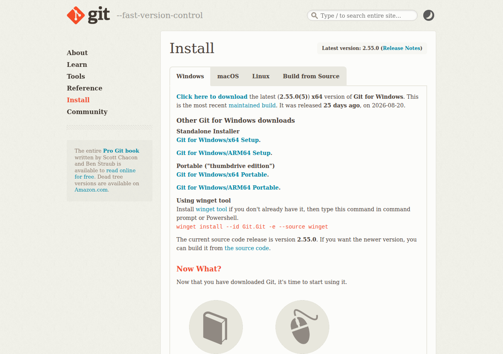
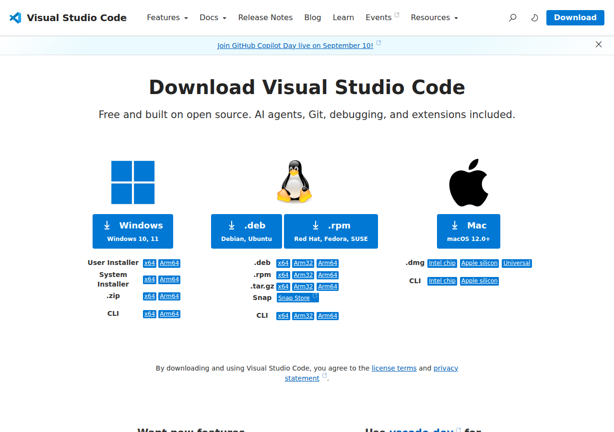
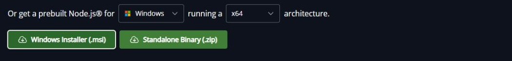
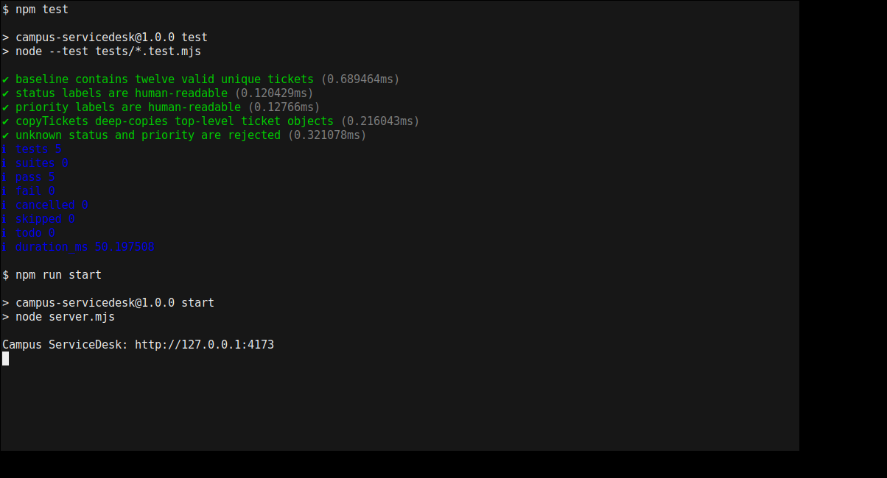
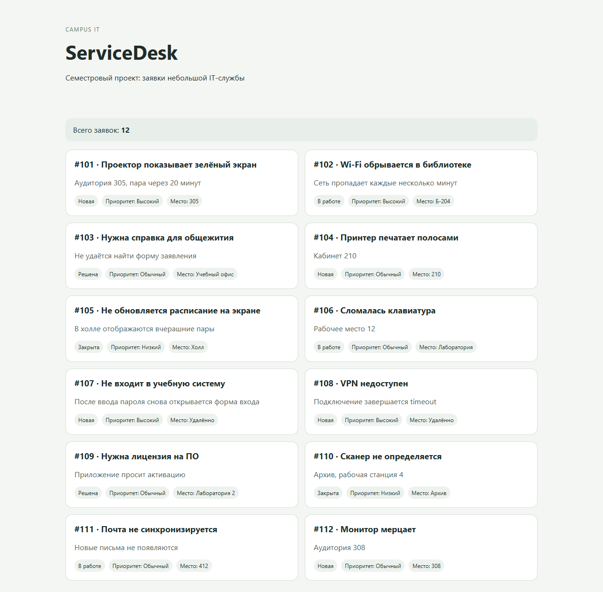

# Настоящие скриншоты к занятию 01

Снимки интерфейсов из официальных инструкций и снимки реально запущенного проекта. Макетов и сгенерированных экранов нет.

Точные названия пунктов меню могут оставаться на английском, как в самой программе. Подписи и объяснения ниже на русском.

## Часть 2. Откуда скачать Git

Настоящая страница загрузки Git. Для обычного компьютера Windows выберите Git for Windows/x64 Setup. Номер версии со временем меняется.

[Официальный источник](https://git-scm.com/install/windows)

## Часть 3. Какой Visual Studio Code скачать

Настоящая страница загрузки Visual Studio Code. В колонке Windows нужен User Installer x64. Это VS Code, а не Visual Studio.

[Официальный источник](https://code.visualstudio.com/Download?_exp_download=fb315fc982)

## Часть 4. Где выбрать Node.js

Нужный блок на настоящей странице Node.js: Windows, x64 и кнопка Windows Installer (.msi). Прокрути страницу до этого блока. Команды Docker выше для нашей работы не нужны.

[Официальный источник](https://nodejs.org/en/download)

## Часть 9. Настоящий запуск тестов и сервера

Снимок настоящего терминала Linux: команды выполняются в исходной версии проекта. В Windows оформление терминала другое; проверяйте итог: 5 тестов без ошибок и адрес 127.0.0.1:4173. Вывод не сгенерирован моделью.

## Часть 9. Так выглядит исходный Campus ServiceDesk

Снимок сделан Playwright на Windows из той же версии проекта, которую студенты клонируют и запускают локально: счётчик показывает 12, заявки имеют номера 101–112, приоритеты и места.

